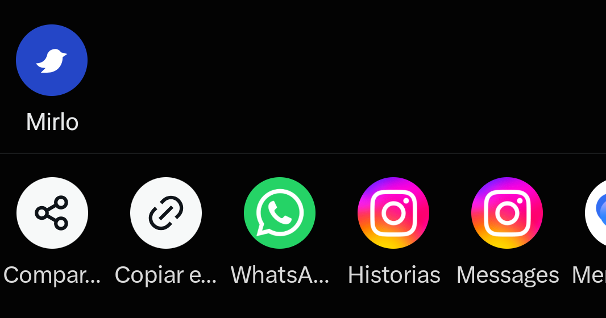

# Send with Mirlo para X

<p align="center"><a href="README.md">English</a> · <b>Español</b></p>

Módulo LSPatch / LSPosed que añade un botón **Mirlo** a la hoja Compartir de la app de X (Twitter) en Android.
Un toque y el post va camino de [Mirlo-desktop](https://github.com/D4vRAM369/Mirlo-desktop), tu bóveda local de
posts de X. No hace falta abrir el ordenador ni pegar enlaces uno a uno.

<p align="center">
  
</p>

```
App de X (LSPatch / LSPosed)                 Send with Mirlo              Ordenador
 Compartir ▸ Mirlo ───────────ID──▶ SendActivity ──▶ <ID>.mirlo ══Syncthing══▶ ~/Mirlo/.inbox ▶ Mirlo-desktop
 Compartir por… ▸ Enviar a Mirlo ──────┘ (funciona también sin módulo)
```

## Funciones

- **Botón Mirlo en la propia hoja Compartir de X**, junto a Copiar enlace. Sin root, con LSPatch.
- **No se pierde nada.** Con el ordenador apagado, los envíos esperan en el móvil y suben en cuanto Syncthing lo ve.
- **Recordatorios configurables**: cada N días y con tu propio texto.
- **Revisión diaria con WiFi**: si hay N posts o más esperando, pregunta *«¿Quieres sincronizar tus posts pendientes
  de enviar a Mirlo-desktop?»*. Pulsas **Aplicar**: arranca Syncthing, espera a que Mirlo-desktop lo guarde todo y le
  devuelve a Syncthing sus propias reglas.
- **Bienvenida** la primera vez, en español o en inglés según el idioma del móvil.
- **Privado**: sin peticiones de red ni cookies de X. Solo ve el enlace que X ya iba a copiar.

## ¿Cómo usar Send with Mirlo?

### 1. Qué necesitas

| Dónde | Qué |
|---|---|
| Ordenador | [Mirlo-desktop](https://github.com/D4vRAM369/Mirlo-desktop/releases/latest) (Linux, Windows o macOS) y [Syncthing](https://syncthing.net/downloads/) |
| Móvil | Android 8.0+, la app de X, [Syncthing-Fork](https://github.com/researchxxl/syncthing-android) y esta app (página Releases) |
| Móvil sin root | [Shizuku Next](https://github.com/rushiranpise/Shizuku-Next/releases/latest) y [LSPatch](https://github.com/JingMatrix/LSPatch/releases/latest) |
| Móvil con root | Magisk o KernelSU con Zygisk, y [Vector](https://github.com/JingMatrix/Vector/releases/latest) (el LSPosed mantenido) |

### 2. Conectar el móvil con Syncthing

**Fácil:** en Mirlo-desktop abre **Conectar móvil** y síguelo. Prepara la carpeta en el ordenador y enseña un QR. En el
móvil: Syncthing-Fork ▸ **Dispositivos** ▸ **+** ▸ icono de QR ▸ escanear. De vuelta en Mirlo-desktop, **Aceptar** el
móvil. En el móvil, acepta la carpeta **Mirlo**.

**A mano:** comparte una carpeta entre el móvil (por ejemplo `Sync/MirloInbox`) y `~/Mirlo/.inbox` del ordenador, en
**«Enviar y recibir» en los dos lados**. Con «Solo enviar» en el móvil, lo que Mirlo-desktop ya guardó nunca se borra
allí y el contador de pendientes no deja de crecer.

### 3. Instalar la app

Instala el APK, ábrelo, pasa la bienvenida y pulsa **Elegir carpeta**: la carpeta de Syncthing del paso 2. La app tiene
que quedarse instalada: es quien escribe en la carpeta.

### 4a. Sin root: Shizuku Next + LSPatch

LSPatch crea una copia de X con el módulo dentro. Shizuku deja que LSPatch la instale sin root, por depuración
inalámbrica.

1. **Activa las opciones de desarrollador:** Ajustes ▸ Información del teléfono ▸ toca **Número de compilación** 7 veces.
2. **Arranca Shizuku Next con depuración inalámbrica:**
   1. Conéctate a una WiFi (la depuración inalámbrica la necesita).
   2. Abre Shizuku Next ▸ **Iniciar mediante depuración inalámbrica** ▸ **Vincular**, y permite su notificación.
   3. Ajustes ▸ Opciones de desarrollador ▸ **Depuración inalámbrica** ▸ actívala ▸ **Vincular dispositivo con código
      de vinculación**.
   4. Escribe el código de 6 cifras en la notificación de Shizuku. Ya vinculado, vuelve a Shizuku y pulsa **Iniciar**.
      Tras reiniciar el móvil solo hay que repetir **Iniciar**; la vinculación se conserva.
3. **Instala LSPatch** desde su [repositorio oficial](https://github.com/JingMatrix/LSPatch/releases/latest): el archivo
   `manager-…-release.apk`. Ábrelo y concede Shizuku cuando lo pida. (El `LSPosed/LSPatch` original está archivado y ya
   no carga módulos como este.)
4. **Parchea X:** LSPatch ▸ **Gestionar** ▸ **+** ▸ elige **X** entre las instaladas ▸ modo **Local** ▸ parchear e
   instalar. En modo local el módulo queda fuera de X: actualizar Send with Mirlo no obliga a parchear X otra vez.
5. **Activa el módulo para X:** Gestionar ▸ Aplicaciones ▸ **X** ▸ desde los módulos instalados ▸ marca
   **Mirlo para X** ▸ **Añadir** ▸ y después **Aplicar** en la barra de abajo. Sin este último toque no se guarda.
6. Fuerza la detención de X y ábrelo.

> Las actualizaciones de X desde Play Store sustituyen la copia parcheada. Cuando pase, vuelve a parchear X (paso 4).

### 4b. Con root: Vector (LSPosed)

1. Con Magisk o KernelSU y Zygisk funcionando (por ejemplo [NeoZygisk](https://github.com/JingMatrix/NeoZygisk)),
   flashea el `Vector-…-Release.zip` de sus [releases](https://github.com/JingMatrix/Vector/releases/latest) desde tu
   gestor de root y reinicia.
2. En el gestor de Vector ▸ Módulos ▸ **Mirlo para X** ▸ actívalo y marca **X** (`com.twitter.android`).
3. Fuerza la detención de X y ábrelo.

El módulo usa la API moderna de Xposed (libxposed 102). Vector la carga; los LSPosed antiguos no. La vía con root aún
no está probada: se agradecen los informes.

### 5. Guardar posts

En X: **Compartir ▸ Mirlo**. Sale *Enviado a Mirlo* y aparece un pequeño archivo `<ID>.mirlo` en la carpeta.
Mirlo-desktop lo recoge en un segundo si está abierto (también en la bandeja del sistema), o la próxima vez que lo
abras. Guarda el post y borra el archivo, y Syncthing lo borra también en el móvil.

¿Sin módulo, o una versión de X que no entiende? **Compartir ▸ Compartir por… ▸ Enviar a Mirlo** hace lo mismo.

### 6. Recordatorios y Aplicar (opcional)

En la app, en **Recordatorios**: cada cuánto avisar, el texto, cuántos pendientes disparan la pregunta con WiFi y cada
cuánto revisar (0 = nunca). Para que **Aplicar** pueda arrancar Syncthing, actívalo una vez en Syncthing-Fork:
**Ajustes ▸ Comportamiento ▸ Control del servicio mediante difusión (broadcast)**.

## Si algo falla

```
adb logcat -s MirloX
```

Esperado: `cargado en com.twitter.android` al abrir X y `botón añadido a la hoja Compartir` al abrir Compartir.
`ventana sin «Copiar enlace»` significa que esa versión de X cambió su hoja Compartir: abre un issue con el log.

## Cómo saca el ID sin depender de X

X ofusca su código y cambia los nombres de sus clases en cada versión, así que el módulo solo se engancha a API de
Android:

| Hook | Qué hace |
|---|---|
| `WindowManagerGlobal.addView` | Ve cada ventana nueva de X. La hoja Compartir es Jetpack Compose (sin vistas clásicas), así que lee su árbol de accesibilidad, el mismo que usa TalkBack, hasta encontrar «Copiar enlace», y superpone el botón **Mirlo** encima de la fila. |
| `ClipboardManager.setPrimaryClip` | Al pulsar **Mirlo** se pulsa por debajo «Copiar enlace» y aquí se coge el enlace que X intenta copiar, **sin tocar tu portapapeles**. |
| `Intent.createChooser` | Si X abre el selector de Android con un post, pone «Enviar a Mirlo» el primero. |
| `Instrumentation.callApplicationOnCreate` | Guarda el `Application` de X para poder abrir `SendActivity`. |

## Compilar

```
./gradlew assembleRelease
```

AGP 8.7.3, Kotlin 2.1.0, [libxposed](https://github.com/libxposed/api) API 102 (solo para compilar). La entrada es
`hook.MirloModule`, declarada en `app/src/main/resources/META-INF/xposed/java_init.list`. R8 está desactivado a
propósito: renombraría esa clase.

## Privacidad

- El módulo no hace peticiones de red ni lee cookies de X.
- La app solo pide notificaciones (recordatorios). Escribe en la carpeta que eliges con el selector de Android.
- Lo que llega al ordenador es un número. Mirlo-desktop lo valida igual que un enlace pegado.

## Licencia

GPL-3.0-or-later, como Mirlo-desktop.
