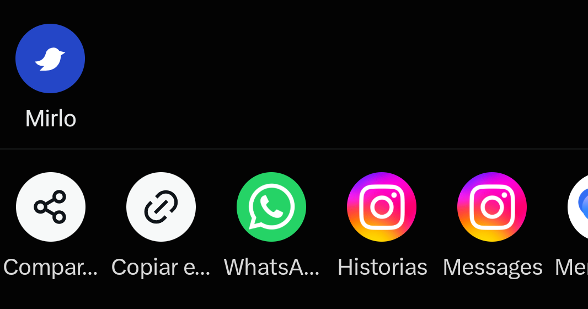

# Send with Mirlo for X

<p align="center"><b>English</b> · <a href="README-ES.md">Español</a></p>

An LSPatch / LSPosed module that adds a **Mirlo** button to the Share sheet of the X (Twitter) Android app.
One tap and the post is on its way to [Mirlo-desktop](https://github.com/D4vRAM369/Mirlo-desktop), your local
vault for X posts. You don't have to open your computer or paste links one by one.

<p align="center">
  
</p>

```
X app (LSPatch / LSPosed)                    Send with Mirlo              Computer
 Share ▸ Mirlo ───────────────ID──▶ SendActivity ──▶ <ID>.mirlo ══Syncthing══▶ ~/Mirlo/.inbox ▶ Mirlo-desktop
 Share via… ▸ Send to Mirlo ───────────┘ (works without the module too)
```

## Features

- **Mirlo button in X's own Share sheet**, next to Copy link. Works without root through LSPatch.
- **Nothing gets lost.** If the computer is off, sends wait on the phone and upload as soon as Syncthing sees it again.
- **Reminders you can set**: every N days, with your own text.
- **Daily check on WiFi**: when N posts or more are waiting, it asks *"Sync your pending posts to Mirlo-desktop?"*.
  Tap **Apply** and it starts Syncthing, waits until Mirlo-desktop has saved everything, then gives Syncthing back its
  own rules.
- **Welcome screens** on first launch, in English, or in Spanish if your phone is in Spanish.
- **Private by design**: no network requests, no X cookies. It only sees the link X was about to copy.

## How to use Send with Mirlo

### 1. What you need

| Where | What |
|---|---|
| Computer | [Mirlo-desktop](https://github.com/D4vRAM369/Mirlo-desktop/releases/latest) (Linux, Windows or macOS) and [Syncthing](https://syncthing.net/downloads/) |
| Phone | Android 8.0+, the X app, [Syncthing-Fork](https://github.com/researchxxl/syncthing-android) and this app (Releases page) |
| Phone, no root | [Shizuku Next](https://github.com/rushiranpise/Shizuku-Next/releases/latest) and [LSPatch](https://github.com/JingMatrix/LSPatch/releases/latest) |
| Phone, root | Magisk or KernelSU with Zygisk, and [Vector](https://github.com/JingMatrix/Vector/releases/latest) (the maintained LSPosed) |

### 2. Connect the phone with Syncthing

**Easy way:** in Mirlo-desktop open **Connect phone** and follow it. It sets up the folder on the computer and shows a
QR code. On the phone: Syncthing-Fork ▸ **Devices** ▸ **+** ▸ QR icon ▸ scan. Back in Mirlo-desktop, **Accept** the
phone. On the phone, accept the **Mirlo** folder.

**By hand:** share a folder between the phone (for example `Sync/MirloInbox`) and `~/Mirlo/.inbox` on the computer,
as **Send & Receive on both sides**. With "Send Only" on the phone, the files Mirlo-desktop already saved never get
deleted there and the pending count keeps growing.

### 3. Install the app

Install the APK, open it, go through the welcome screens and **Choose folder**: pick the Syncthing folder from step 2.
Keep the app installed. It is the one that writes to the folder.

### 4a. Without root: Shizuku Next + LSPatch

LSPatch builds a copy of X with the module inside. Shizuku lets LSPatch install that copy without root, through
wireless debugging.

1. **Turn on developer options:** Settings ▸ About phone ▸ tap **Build number** 7 times.
2. **Start Shizuku Next with wireless debugging:**
   1. Connect to a WiFi network (wireless debugging needs one).
   2. Open Shizuku Next ▸ **Start via Wireless debugging** ▸ **Pairing**, and allow its notification.
   3. Settings ▸ Developer options ▸ **Wireless debugging** ▸ turn it on ▸ **Pair device with pairing code**.
   4. Type the 6-digit code into Shizuku's notification. Once paired, go back to Shizuku and tap **Start**.
      After a reboot you only repeat **Start**; the pairing is kept.
3. **Install LSPatch** from its [official repository](https://github.com/JingMatrix/LSPatch/releases/latest):
   the `manager-…-release.apk` file. Open it and allow Shizuku when asked. (The original `LSPosed/LSPatch` is
   archived and no longer loads modules like this one.)
4. **Patch X:** LSPatch ▸ **Manage** ▸ **+** ▸ pick the installed **X** ▸ **Local** mode ▸ patch and install.
   Local mode keeps the module outside X, so updating Send with Mirlo doesn't mean patching X again.
5. **Enable the module for X:** Manage ▸ Apps ▸ **X** ▸ module scope (from installed modules) ▸ tick
   **Mirlo for X** ▸ **Add** ▸ and then **Apply** in the bottom bar. Without that last tap nothing is saved.
6. Force-stop X and open it again.

> X updates from the Play Store replace the patched copy. When that happens, patch X again (step 4).

### 4b. With root: Vector (LSPosed)

1. With Magisk or KernelSU and Zygisk working (for example [NeoZygisk](https://github.com/JingMatrix/NeoZygisk)),
   flash the `Vector-…-Release.zip` from its [releases](https://github.com/JingMatrix/Vector/releases/latest) in your
   root manager and reboot.
2. In the Vector manager ▸ Modules ▸ **Mirlo for X** ▸ turn it on and tick **X** (`com.twitter.android`).
3. Force-stop X and open it again.

The module uses the modern Xposed API (libxposed 102). Vector loads it; old LSPosed builds don't. The root path hasn't
been tested yet: reports are welcome.

### 5. Save posts

In X: **Share ▸ Mirlo**. A toast says *Sent to Mirlo* and a small `<ID>.mirlo` file appears in the folder.
Mirlo-desktop picks it up within a second if it is open (also from the system tray), or the next time you open it.
It saves the post and deletes the file, and Syncthing deletes it on the phone as well.

No module, or a version of X it doesn't understand? **Share ▸ Share via… ▸ Send to Mirlo** does the same.

### 6. Reminders and Apply (optional)

In the app, under **Reminders**: how often to remind you, the text, how many pending posts trigger the WiFi question
and how often to check (0 = never). For **Apply** to start Syncthing, enable it once in Syncthing-Fork:
**Settings ▸ Behaviour ▸ Service control by broadcast**.

## Troubleshooting

```
adb logcat -s MirloX
```

You should see `cargado en com.twitter.android` when X opens and `botón añadido a la hoja Compartir` when you open Share.
`ventana sin «Copiar enlace»` means that version of X changed its Share sheet: open an issue with the log.

## How it gets the post ID without depending on X

X obfuscates its code and renames classes in every release, so the module only hooks Android APIs:

| Hook | What it does |
|---|---|
| `WindowManagerGlobal.addView` | Sees each new X window. The Share sheet is Jetpack Compose (no classic views), so it reads the accessibility tree, the same one TalkBack uses, until it finds "Copy link", and overlays the **Mirlo** button above the row. |
| `ClipboardManager.setPrimaryClip` | Tapping **Mirlo** taps "Copy link" underneath and catches the link X tries to copy, **without touching your clipboard**. |
| `Intent.createChooser` | If X opens Android's chooser with a post, puts "Send to Mirlo" first. |
| `Instrumentation.callApplicationOnCreate` | Keeps X's `Application` so it can open `SendActivity`. |

## Build

```
./gradlew assembleRelease
```

AGP 8.7.3, Kotlin 2.1.0, [libxposed](https://github.com/libxposed/api) API 102 (compile only). The entry point is
`hook.MirloModule`, declared in `app/src/main/resources/META-INF/xposed/java_init.list`. R8 is off on purpose: it would
rename that class.

To sign a release, copy `keystore.properties.example` to `keystore.properties` in the folder that contains this repo
(or in the repo root, ignored by git) and fill it in.
Without it, `assembleRelease` produces an unsigned APK.

## Privacy

- The module makes no network requests and reads no X cookies.
- The app only asks for notifications (reminders). It writes to the folder you pick with Android's own picker.
- What reaches the computer is a number. Mirlo-desktop validates it like a pasted link.

## License

GPL-3.0-or-later, like Mirlo-desktop.
